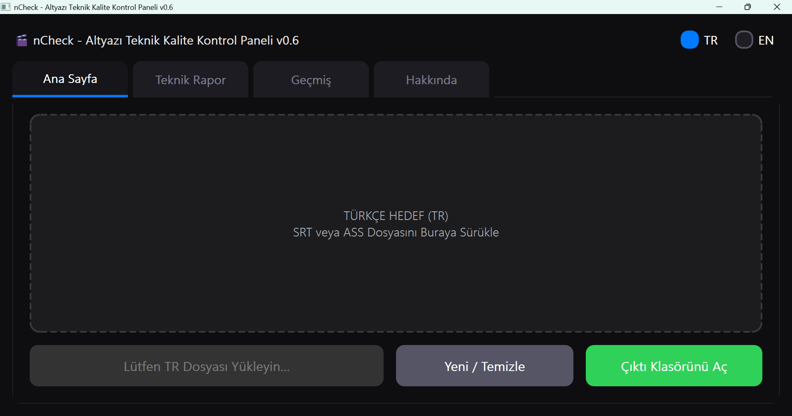
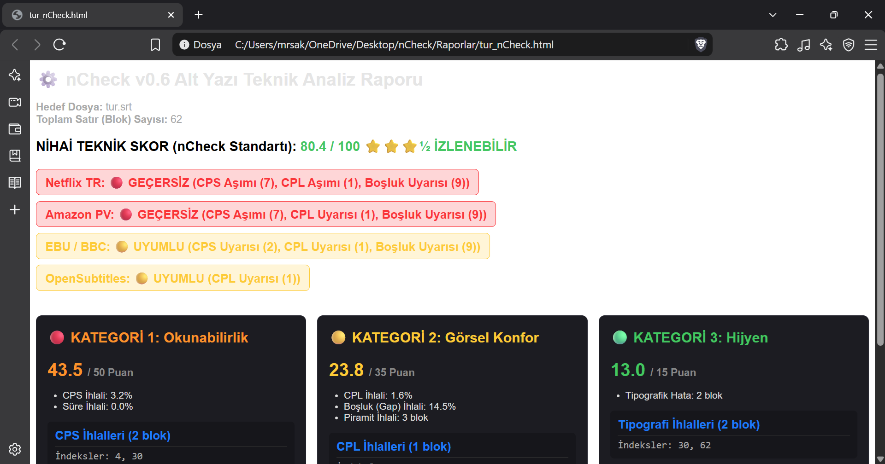

# 🎬 nCheck v0.6 - Otonom Altyazı Teknik Kalite Kontrol Paneli

> **MQM (Multidimensional Quality Metrics) standartlarını baz alan SRT ve ASS altyazı dosyaları için teknik denetim motoru.**

---

🇹🇷 **Türkçe** | [🇬🇧 English](README.md)




## 📌 Genel Bakış

**Geliştirici:** nutuzar
**Sürüm:** v0.6 (Kararlı)
**Lisans:** GPL-3.0

nCheck, SRT ve ASS formatındaki altyazı dosyalarının teknik yeterliliğini, uluslararası yayıncılık standartlarına (MQM) göre denetleyen bir kalite kontrol (QC) aracıdır. Çevirinin anlamsal veya dilbilgisi kalitesine müdahale etmez; odağı tamamen **okunabilirlik, görsel ergonomi ve teknik yerleşimdir.**

Devasa altyazı arşivleri oluşturanlar, çevirmenler ve kalite güvence (QA) süreçlerini otomatize etmek isteyen kullanıcılar için tasarlanmıştır. Yüklenen her dosyayı analiz ederek hataları tespit eder, objektif bir kalite skoru (0-100) hesaplar ve yazdırmaya hazır bir HTML raporu üretir.

---

## 🚀 Temel Özellikler

* **Otonom Çok Katmanlı Analiz:** Dosya sürüklendiği an binlerce satırı milisaniyeler içinde tarar. nCheck Türkçe standartları (19.5 CPS, 42 CPL, 84ms boşluk, 833ms minimum süre) üzerinden 100 üzerinden sanatkârane bir kalite puanı hesaplarken, eşzamanlı olarak Netflix, Amazon, EBU ve OpenSubtitles gibi küresel platformların katı yayın standartlarına göre de sektörel uyumluluk (Geçti/Kaldı) denetimi yapar.
* **Dil-Körü Mimari ve JSON Esnekliği:** Başka bir dildeki (örn: Almanca) kaynak dosyalarınız için farklı teknik limitler kullanmak isterseniz, bu değerleri doğrudan sistemin kalbindeki JSON sözlüğüne (INDUSTRY_PROFILES) saniyeler içinde yeni bir profil olarak zahmetsizce ekleyebilirsiniz.


---

## 📊 Derecelendirme Skalası

nCheck, dosyanın aldığı nihai puana göre (0-100) aşağıdaki sınıflandırmalardan birini atar:

* `0 - 59` : 🔴 **REDDEDİLDİ / YETERSİZ**
* `60 - 64`: 🟡 **VASAT**
* `65 - 69`: 🟡 **VASAT ÜSTÜ**
* `70 - 79`: 🟢 **İZLENEBİLİR**
* `80 - 89`: 🟢 **İYİ**
* `90 - 94`: 🔵 **ÇOK İYİ**
* `95 - 100`: 🔵 **ARŞİVLİK**

---

## 📜 nCheck Kalite Değerlendirme Manifestosu (MQM)

nCheck'in puanlama algoritması, küresel yayın endüstrisi standartlarına dayanır. Toplam 100 puan, üç farklı ağırlık merkezine (%50, %35, %15) bölünmüştür. Ayrıca skordan bağımsız çalışan bir "İnfaz Kurulu" (Kategori 0) mevcuttur.

*(Not: Dilbilgisi ve imla kontrolü nCheck'in değil, ekosistemin diğer parçası olan **nSpell** uygulamasının görevidir.)*

### ⛔ KATEGORİ 0: Kritik Hatalar (Puanlama Dışı / Doğrudan Ret)
Bu kategorideki ihlaller altyazının temel yayın standartlarını bozar ve oynatıcıların çökmesine neden olabilir. Bir dosya 99 puan bile alsa, aşağıdaki hatalardan birini barındırıyorsa doğrudan **REDDEDİLDİ** durumuna düşer:
* **Zaman Kodu Çakışması (Overlapping):** Bir altyazı bloğu bitmeden diğerinin başlaması.
* **Çoklu Satır İhlali:** Ekranda tek bir blokta 3 veya daha fazla satırın yer alması.
* **Negatif Süre (Zamansal Paradoks):**  Bir bloğun bitiş zamanının, kendi başlangıç zamanından daha erken olması durumu.

### 🔴 KATEGORİ 1: Okunabilirlik ve Akış (Maksimum 50 Puan)
İzleyicinin metni filmin temposundan kopmadan okuyabilme kapasitesini ölçer.
* **CPS İhlali:** Saniyede okunan karakter (Karakter/Saniye) limitinin aşılması.
* **Flaş Altyazılar:** Ekranda insan gözünün algılayamayacağı kadar kısa (örn: 0.7sn altı) kalan metinler.
* **Zombi Altyazılar:** Ekranda gereksiz yere uzun (örn: 7sn üstü) kalan metinler.

### 🟡 KATEGORİ 2: Görsel Konfor ve Yerleşim (Maksimum 35 Puan)
Metnin ekranda kapladığı alan ve gözü yorma potansiyeli bu kategoride değerlendirilir.
* **CPL İhlali:** Satır başına düşen karakter (Karakter/Satır) limitinin aşılması.
* **Frame Gap (Boşluk) İhlali:** İki altyazı arasında yeterli boşluğun (örn: 24ms) bırakılmaması sonucu oluşan titreme (flicker) etkisi.
* **Piramit (Satır Dengesi) İhlali:** İki satırlık bloklarda üst ve alt satırın karakter sayıları arasında uçurum olması (dikey dengesizlik).

### 🟢 KATEGORİ 3: Tipografik Hijyen (Maksimum 15 Puan)
Dosyanın tipografik işçiliğini denetler. Oran hesabı yerine ihlal başına maktu ceza kesilir.
* Kelimeler arası gereksiz çift boşluklar.
* Noktalama işaretlerinden önce bırakılan kuraldışı boşluklar.
* Kapatılmamış veya hatalı yazılmış HTML biçimlendirme etiketleri (`<i>`, `<b>` vb.).
* Üç nokta (...) istismarı veya kuraldışı sembol kullanımları.

---

## 🛠️ Kurulum ve Kullanım

**Gereksinimler:**
* Python 3.8 veya üzeri
* PyQt5
* pysrt

**Kurulum:**
Bağımlılıkları yükleyin:
```bash
pip install PyQt5 pysrt